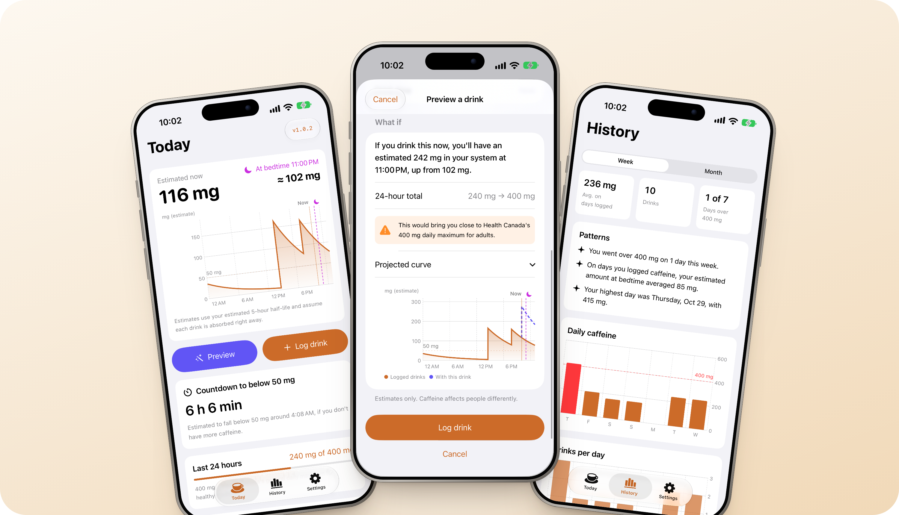
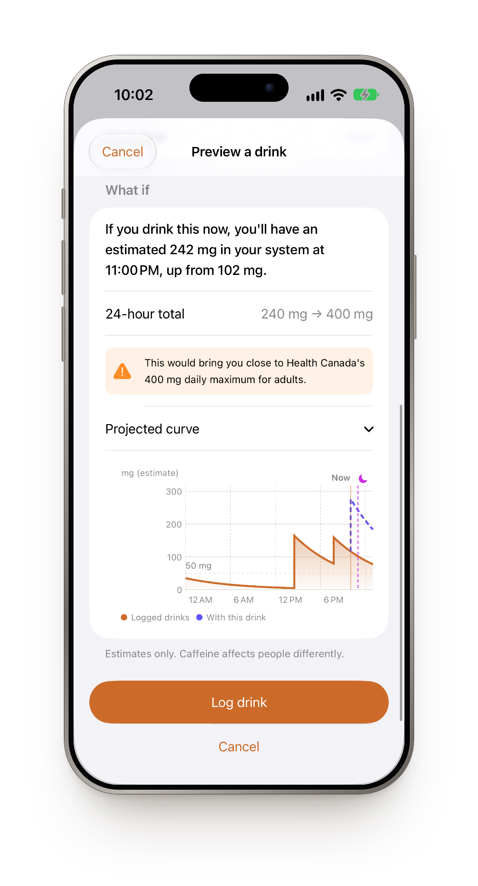
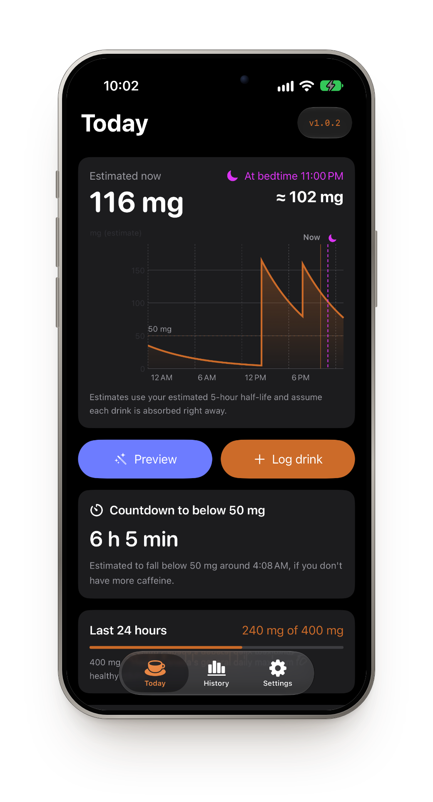
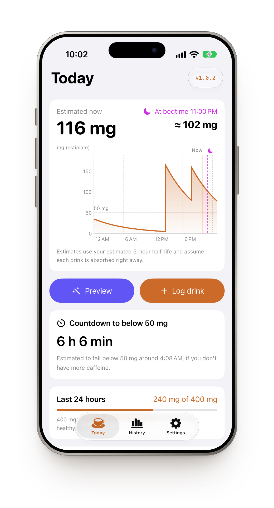
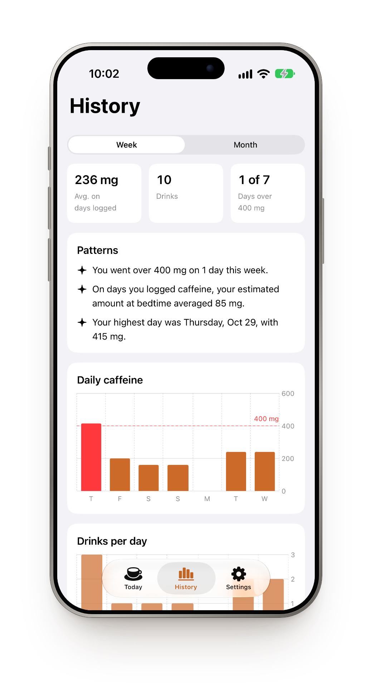
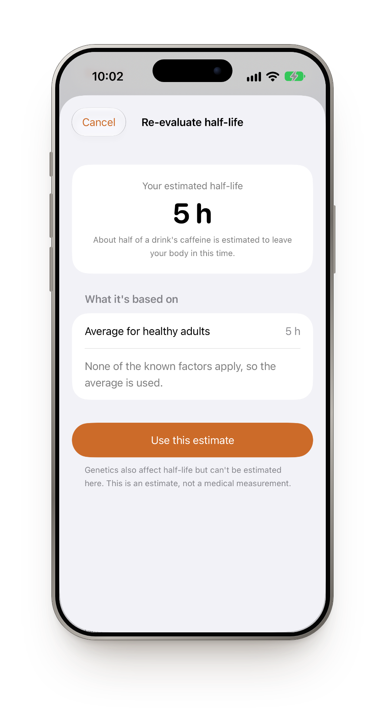
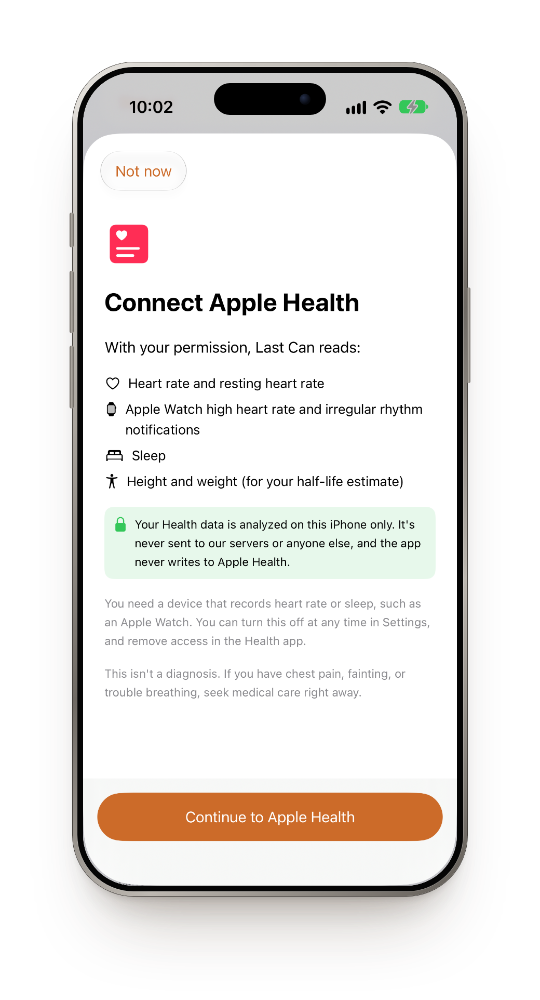

<p align="center">
  
</p>

<h1 align="center">Last Can</h1>

<p align="center">
  <b>Know what's still in you before the last can.</b><br>
  A caffeine tracker for students who run on energy drinks.
</p>

<p align="center">
  <a href="https://last-can-two.vercel.app"><b>Website</b></a> &nbsp;·&nbsp;
  <a href="https://last-can-two.vercel.app/#join"><b>Get early access</b></a> &nbsp;·&nbsp;
  <a href="#for-developers"><b>Build it yourself</b></a>
</p>

<p align="center">
  
  
  
</p>

<p align="center">
  
</p>

## What it does

Last Can shows how much caffeine is likely still in your system, how much will be left at bedtime, and what one more drink would change, **before you open it**. It doesn't tell you what to do. It makes the trade-off visible at the moment you're deciding.

## How to use it

1. **Sign in** with your `@uwaterloo.ca` email and accept the disclaimer.
2. **Set up in a minute:** your age, usual drink, typical bedtime and any health conditions. Last Can estimates your personal caffeine half-life from this.
3. **Before your next drink, tap Preview.** Pick the drink and read one sentence: how much you'd have at bedtime, up from how much now.
4. **Log it** (or don't). Choose a saved drink, scan the label, or type the milligrams.
5. **Watch the countdown** to when your estimate drops below your chosen level. You'll get a notification when it does.
6. **Check History once a week** for patterns, like caffeine after 8 p.m. or days over 400 mg.

## Features

<table>
  <tr>
    <td width="42%" align="center"></td>
    <td>
      <h3>See tonight before you drink</h3>
      Pick a drink and the curve redraws with it. You get a plain-language projection at your bedtime and your new 24-hour total. Nothing is logged until you decide.
    </td>
  </tr>
  <tr>
    <td>
      <h3>A countdown to a calmer night</h3>
      Set a level, say 50 mg, and Last Can counts down to when your estimate falls below it. Log another drink and the timer moves right away. Works in light and dark mode.
    </td>
    <td width="42%" align="center"></td>
  </tr>
  <tr>
    <td width="42%" align="center"></td>
    <td>
      <h3>400 mg, always in view</h3>
      A rolling 24-hour total against Health Canada's 400 mg daily maximum for healthy adults. Last Can warns you from 300 mg and asks before you log past 400.
    </td>
  </tr>
  <tr>
    <td>
      <h3>Patterns you'd miss on your own</h3>
      Weekly and monthly charts of daily totals, drinks, days over the limit and caffeine at bedtime, plus short notes like <i>"You had caffeine after 8 p.m. on 5 days this week."</i>
    </td>
    <td width="42%" align="center"></td>
  </tr>
  <tr>
    <td width="42%" align="center"></td>
    <td>
      <h3>Your half-life, not just the average</h3>
      Certain medications, pregnancy, liver health, age and body size change how fast caffeine clears. Last Can estimates your half-life from published research and shows what it's based on. Re-evaluate any time.
    </td>
  </tr>
  <tr>
    <td>
      <h3>Private by design</h3>
      Your drinks, health conditions and any Apple Health data stay on your phone. Nothing is sent to a server. Health insights are optional, run on the device, and are worded as observations, never diagnoses.
    </td>
    <td width="42%" align="center"></td>
  </tr>
</table>

## Good to know

- All amounts are **estimates** based on a standard caffeine model. Caffeine affects people differently.
- Last Can never says a drink is "safe" and never calculates a personal limit if you've listed a health condition. It suggests talking to a doctor instead.
- For adults 18 and over.

> **Disclaimer:** This app provides estimates for tracking purposes only and isn't medical advice. If you have a health condition or concern, consult a healthcare professional. If you have severe symptoms, seek medical care right away.

<details id="for-developers">
<summary><b>For developers</b></summary>

### Run

Open `CaffeineTracker.xcodeproj` in Xcode (the project and target keep the internal name CaffeineTracker; the app shows as "Last Can") and run the **CaffeineTracker** scheme on an iPhone simulator (iOS 18+). Tests: `⌘U`, or

```bash
xcodebuild -project CaffeineTracker.xcodeproj -scheme CaffeineTracker -destination 'platform=iOS Simulator,name=iPhone Air' test
```

Debug builds have **Settings → Developer → Add 30 days of sample drinks**, or launch with `-seedDemoData` to load demo data automatically.

### Where things live

| Area | Files |
|---|---|
| Estimate math (half-life sum, 24 h total, countdown, bedtime) | `CaffeineTracker/Logic/CaffeineModel.swift` |
| History stats and insight sentences | `Logic/HistoryStats.swift` |
| Label OCR (Vision, on device) and caffeine/serving parsing | `Logic/TextRecognizer.swift`, `Logic/LabelParser.swift` |
| Countdown notification | `Logic/CaffeineNotifier.swift` |
| Personal half-life estimate | `Logic/HalfLifeEstimator.swift`, `Views/Settings/ReevaluateHalfLifeView.swift` |
| Apple Health reading and on-device pattern rules | `Logic/HealthDataStore.swift`, `Logic/HealthAnalyzer.swift` |
| Daily greeting, changelog, version badge | `Logic/DailyGreeting.swift` |
| Profile, conditions, sign-in (UserDefaults, on device) | `Models/ProfileStore.swift` |
| Drink log and saved drinks (SwiftData, local only) | `Models/DrinkModels.swift` |
| Screens | `Views/Onboarding/`, `Views/Home/`, `Views/Drink/`, `Views/History/`, `Views/Settings/` |
| Product website | `product page/` (deployed on Vercel) |
| README phone mockups | `Design/readme-mockups/mockup.html` |

### How the estimate works

Remaining caffeine is the sum over logged drinks of `dose × 0.5^(hours since drink ÷ half-life)`, with each drink treated as absorbed immediately. The countdown finds when that sum drops below your threshold with a bisection search. The half-life starts at 5 h and applies multipliers from published research (Nehlig 2018, Pharmacol Rev; Grzegorzewski et al. 2021, Front Pharmacol): CYP1A2-inhibiting medication ×2, liver condition ×2, pregnancy ×1.8, age 65+ ×1.2, BMI 30+ ×1.15, clamped to 2–8 h.

### Choices worth knowing

- "Late caffeine" counts drinks from 8 p.m. up to 4 a.m., on the calendar day the drink was logged.
- History "days over 400 mg" uses calendar-day totals; the main screen and the logging warning use the rolling 24-hour total.
- Bedtime is the next occurrence after now, so at 12:30 a.m. with an 11 p.m. bedtime, the app shows the following night.
- Sign-in checks the email format only (no SSO yet).
- When you add a release, add an entry at the top of `Changelog.entries` and bump `MARKETING_VERSION`.

</details>

---

<sub>Independent student project. Not affiliated with or endorsed by the University of Waterloo. Apple Health is a trademark of Apple Inc.</sub>
